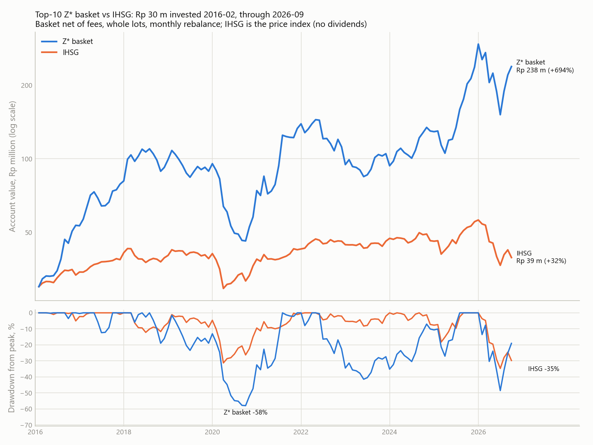

# Basket vs IHSG, 2016-02..2026-09

Rp 30,000,000 in the top-10 Z* basket account (net of fees, whole lots, dividends reinvested) against the same amount in the IDX Composite. IHSG is the price index: it excludes dividends (roughly 2-3% a year) and any cost of holding it, so the basket's edge is overstated by about that much.

## Performance by window

|  | window | portfolio | months | total_% | CAGR_% | ann_vol_% | sharpe | max_DD_% | worst_month_% | hit_% |
|---|---|---|---|---|---|---|---|---|---|---|
| 0 | full | Z* basket | 128.00 | 694.03 | 21.44 | 34.28 | 0.59 | -57.98 | -24.54 | 57.03 |
| 1 | full | IHSG | 128.00 | 31.55 | 2.60 | 14.70 | -0.08 | -34.74 | -16.76 | 58.59 |
| 2 | 10y | Z* basket | 120.00 | 427.57 | 18.09 | 34.68 | 0.51 | -57.98 | -24.54 | 55.83 |
| 3 | 10y | IHSG | 120.00 | 13.17 | 1.24 | 15.00 | -0.16 | -34.74 | -16.76 | 58.33 |
| 4 | 5y | Z* basket | 60.00 | 94.65 | 14.25 | 35.12 | 0.41 | -48.55 | -24.54 | 58.33 |
| 5 | 5y | IHSG | 60.00 | -3.43 | -0.70 | 15.68 | -0.29 | -34.74 | -14.42 | 55.00 |
| 6 | 3y | Z* basket | 36.00 | 128.96 | 31.80 | 40.03 | 0.76 | -48.55 | -24.54 | 63.89 |
| 7 | 3y | IHSG | 36.00 | -12.52 | -4.36 | 19.25 | -0.42 | -34.74 | -14.42 | 52.78 |
| 8 | 1y | Z* basket | 12.00 | 17.67 | 17.67 | 58.69 | 0.47 | -48.55 | -24.54 | 66.67 |
| 9 | 1y | IHSG | 12.00 | -24.69 | -24.69 | 25.14 | -1.19 | -34.74 | -14.42 | 41.67 |

## Relative to IHSG (full period)

| measure | value |
|---|---|
| months basket beat IHSG_% | 57.81 |
| years basket beat IHSG | 7 of 11 |
| correlation | 0.61 |
| beta to IHSG | 1.42 |
| alpha_%/yr | 22.13 |
| tracking_error_%/yr | 27.91 |
| information_ratio | 0.77 |

## Calendar years (%)

|  | year | Z* basket | IHSG | excess_pp |
|---|---|---|---|---|
| 0 | 2016.00 | 77.40 | 14.80 | 62.60 |
| 1 | 2017.00 | 52.50 | 20.00 | 32.50 |
| 2 | 2018.00 | 22.30 | -2.50 | 24.80 |
| 3 | 2019.00 | -3.90 | 1.70 | -5.60 |
| 4 | 2020.00 | -22.40 | -5.10 | -17.30 |
| 5 | 2021.00 | 87.50 | 10.10 | 77.40 |
| 6 | 2022.00 | -31.90 | 4.10 | -36.00 |
| 7 | 2023.00 | -1.10 | 6.20 | -7.30 |
| 8 | 2024.00 | 37.80 | -2.70 | 40.50 |
| 9 | 2025.00 | 128.00 | 22.10 | 105.90 |
| 10 | 2026.00 | -19.10 | -29.80 | 10.70 |

